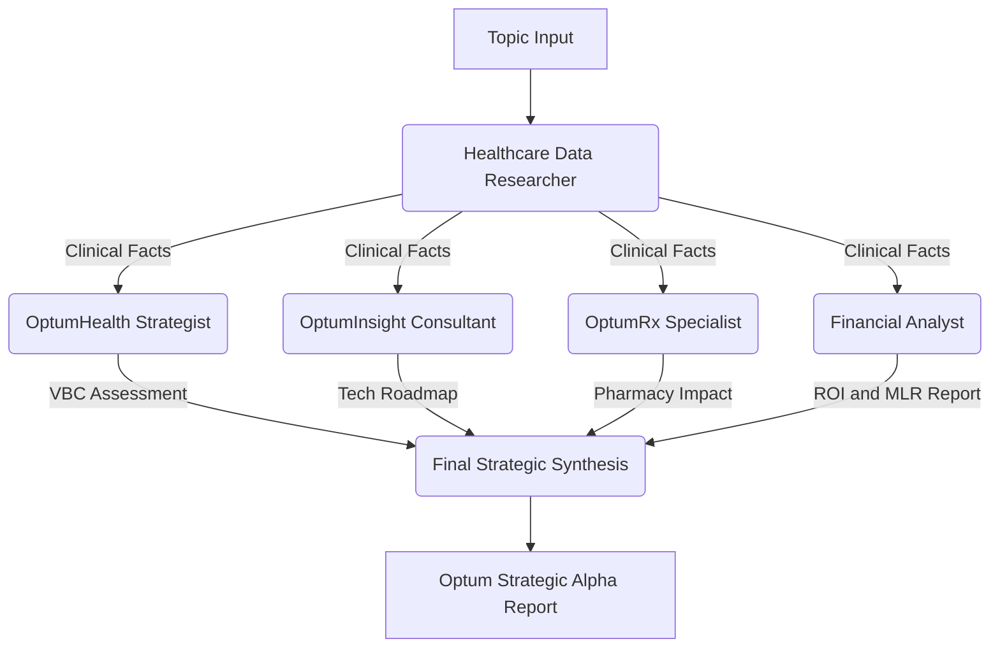

# Optum Strategic Alpha: Agent Architecture & Objectives

This document outlines the design and operational logic of the multi-agent research crew developed for Optum’s strategic business analysis.

## 🎯 System Vision
The goal of this system is to automate **Evidence-Based Strategic Intelligence**. Instead of a general AI summary, this crew performs a "Surgical Deep-Dive" into healthcare breakthroughs, analyzing them through the distinct lenses of Optum’s three core business streams: **Health, Insight, and Rx.**

---

## 👥 The Agent Roster

| Agent | Role | Objective | Key Metrics |
| :--- | :--- | :--- | :--- |
| **Healthcare Data Researcher** | Foundation | Extract ground-truth facts, clinical trial data, and FDA status. | Efficacy %, Patient Count, Trial Phase. |
| **OptumHealth Strategist** | Clinical Value | Translate clinical facts into Value-Based Care (VBC) models. | Readmission risk, Home-health scalability. |
| **OptumInsight Consultant** | Tech & Analytics | Identify DaaS (Data-as-a-Service) and AI productization ops. | Workflow automation, RCM efficiency. |
| **OptumRx Specialist** | Pharmacy Benefits | Analyze specialty drug trend and formulary impact. | PBM cost, Prior auth complexity. |
| **Optum Financial Analyst** | Fiscal Intelligence | Project ROI, MLR impact, and capital allocation for new therapies. | IRR, NPV, MLR basis points, Break-even timeline. |

---

## 🖼️ Architectural Blueprint

---

## ⚙️ How it Works: The Sequential Pipeline

The crew uses a **Sequential Process**. This ensures "Data Integrity" where each agent builds upon the verified output of the previous one.

### 1. The Fact-Finding & Precision Layer (Researcher)
*   **Action**: Uses a multi-tool stack consisting of **Google Search (Serper)**, **Agent-Search (Tavily)**, and **Website Scraping**.
*   **Logic**: 
    1. **Primary Search**: Scans the web using Serper and Tavily for high-fidelity clinical links.
    2. **Deep Drill-Down**: Once a value-dense URL is identified, the agent automatically triggers the **Scraper** to read the full technical data table.
    3. **Ground Truth Extraction**: This "Search-to-Scrape" loop ensures 100% accuracy, moving beyond snippets to full-text clinical evidence.
*   **Optimization**: Uses an **Adaptive Research Tier** (Primary: Llama 3.1 8B; Secondary: Mistral Small) to handle high-volume data gathering with cost efficiency and redundancy.

### 2. The Strategic Analysis Layer (Strategists)
*   **Action**: Evaluates the Researcher's findings against Optum’s specific business models.
*   **Logic**: Each agent uses a distinct "backstory" (context) to filter the information differently.
    *   *Health* looks for patient outcomes.
    *   *Insight* looks for data software opportunities.
    *   *Rx* looks for cost and prior-authorization hurdles.
*   **Optimization**: Uses the **High-IQ Strategy Tier** (Primary: Llama 3.3 70B; Failover: Mistral Large / Ollama 120B) for superior reasoning and professional business synthesis.

### 3. The Fiscal Intelligence Layer (Financial Analyst)
*   **Action**: Receives the Researcher's ground-truth clinical data and performs CFO-grade financial modeling.
*   **Output**: A fiscal impact brief covering:
    - **ROI Projection**: 3–5 year return on Optum's investment in the therapy/technology.
    - **MLR Delta**: Whether adoption will reduce or increase medical claims spend.
    - **Break-even Timeline**: How many quarters before the investment turns profitable.
    - **Capital Recommendation**: Invest / Watch / Avoid, with reasoning.
*   **Optimization**: Uses **Groq 70B** (primary) with full failover to Mistral Large for high-IQ numeric reasoning.

### 4. The Synthesis Layer
The final task combines the three stream reports into an **Executive Summary**. This creates "Strategic Alpha"—insights that are not just informative, but actionable for 2025 planning.

---

## 💾 Persistence & Reporting
To prevent data loss from session timeouts or rate limits, the system includes an **Automated Artifact Generation** layer:
*   **Automatic Backup**: Every completed strategic report is automatically saved to the `reports/` directory.
*   **Structured Metadata**: Files are timestamped and named by topic (e.g., `Strategic_Alpha_Topic_YYYY-MM-DD.md`) for easy auditing and retrieval.
*   **Markdown Ready**: The output is formatted in clean Markdown, ready for immediate distribution across Optum leadership teams.

---

## 🛡️ Connectivity & Stability (Adaptive Brain)
> [!IMPORTANT]
> **Resilient Multi-LLM Strategy**: We utilize a hierarchical failover system (Groq -> Mistral -> Ollama) to ensure 100% mission uptime regardless of single-provider rate limits or outages.

> [!TIP]
> **Clean Signal Output**: Every agent utilizes the **Content Shield** to ensure the final report is surgically stripped of technical JSON metadata.

43. **Model Routing**: Automated via `ResilientLLM` stateless factory.
44. **Environment**: Python 3.10+ with `litellm` and `crewai`.
45. **Persistence**: Sanitized Markdown reporting to the `./reports` directory.

---
*Created by Antigravity for Optum Strategy Teams.*
