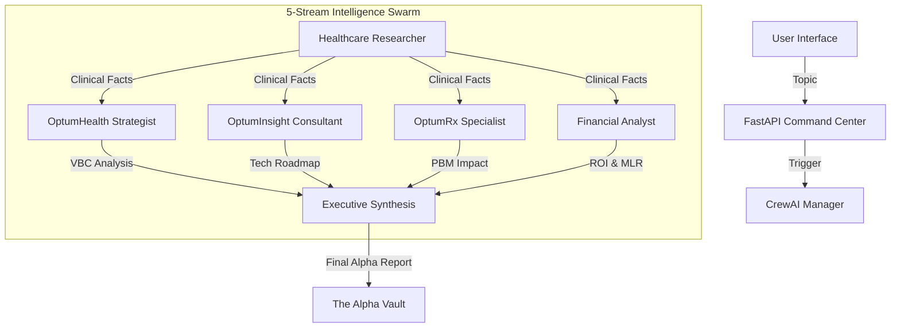

# Platform Architecture: Optum Strategic Alpha

## 1. System Overview
Optum Strategic Alpha is an **end-to-end intelligence platform**. It moves beyond standard RAG by combining autonomous web exploration with deep vertical-market expertise. The platform is designed to take a raw user request and orchestrate a team of digital specialists to produce actionable research artifacts.

---

## 2. The Chain of Responsibility

### A. The Intake Layer (FastAPI & Dispatch)
- **File**: `api.py`
- **Role**: The "Mission Dispatcher."
- **Logic**: Receives the user topic. It initializes the `OptumStrategicCrew` class and monitors the background thread. It streams standard output (stdout) back to the frontend in real-time via Server-Sent Events (SSE).

### B. The Intelligence Scout (Healthcare Researcher)
- **Agent**: `healthcare_researcher` (Llama 3.1 8B)
- **Role**: The de-facto **Intent Auditor**.
- **The "Tool Switch"**: Based on the complexity of the topic, the agent autonomously decides:
    - **Serper (Google)**: For news and broad medical landscapes.
    - **Tavily**: For optimized, clean LLM snippets.
    - **Website Scraper**: For deep extraction of clinical trial tables or technical PDFs.
- **Output**: A 500-word "Ground Truth" briefing.

### C. The 5-Stream Specialist Panel
- **Agents**: `health_strategist`, `insight_analyst`, `rx_specialist`, `financial_analyst` (Groq 70B / Mistral Large / Ollama 120B)
- **Role**: Parallel domain-specific synthesis — all receive the same clinical facts and interpret them through their distinct business lenses.
- **Streams**:
    - **OptumHealth**: Value-Based Care impact, readmission risk, network scalability.
    - **OptumInsight**: DaaS and AI workflow productization opportunities.
    - **OptumRx**: PBM strategy, formulary placement, specialty drug spend.
    - **Financial Analyst**: ROI projection, MLR delta, break-even timeline, capital recommendation.

### D. The Executive Publisher (Synthesis)
- **Role**: Final document collation across all 5 streams.
- **Logic**: Integrates Clinical Context, Care Delivery, Tech & AI, Pharmacy & PBM, Financial Impact, and Strategic Recommendation into a single executive-ready brief.

---

## 3. The Resilient Multi-LLM Strategy (Adaptive Brain)
To ensure **Enterprise Continuity** and maximize reasoning precision while respecting provider rate limits:

1. **Tiered Failover Hierarchy**: 
    - **Primary (Groq)**: Llama 3.1 8B for high-speed research; Llama 3.3 70B for high-IQ strategy.
    - **Secondary (Mistral AI)**: Mistral Small/Large fallback to ensure mission completion during Groq outages.
    - **Tertiary (Ollama Cloud)**: GPT-OSS 120B for deep pharmacy and specialty clinical synthesis.
2. **The Clean Signal Shield**: Every model response is processed through a stateless proxy that surgically strips technical JSON metadata, delivering 100% professional markdown reports.
3. **Stateless Resilience**: The platform tracks 429 (Rate Limit) and 503 (Overloaded) errors in real-time, autonomously pivoting to the next provider in the hierarchy without user intervention.

---
*Generated by Antigravity for Optum Engineering.*
