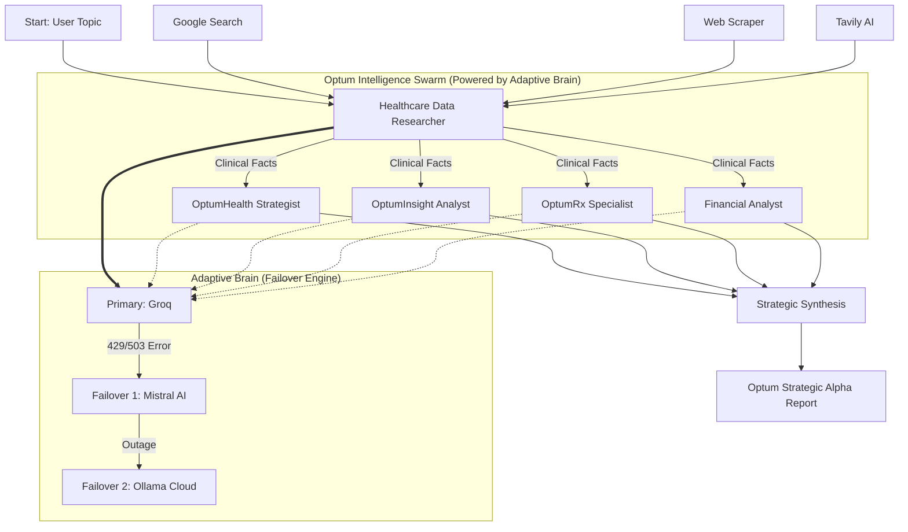

# Optum Strategic Architecture: 3-Stream Multi-Agent Workflow

This document describes the "Lean" 4-agent workflow designed specifically for Optum's business ecosystem (OptumHealth, OptumInsight, OptumRx).

## System Diagram

## Agent Roles & Business Context

### 1. Healthcare Data Researcher (Foundation)

- **Role**: Information Hunter & Fact Checker.
- **Business Context**: Provides the raw, technical "Single Source of Truth" that feeds all Optum units.
- **Objective**: Scour clinical trials and technical breakthroughs for the 5 most significant data points.

### 2. OptumHealth Strategist (Care Delivery Lens)

- **Role**: Value-Based Care (VBC) Auditor.
- **Business Context**: Focused on "OptumHealth" goals—improving patient outcomes while managing provider risk.
- **Objective**: Determine how a technical breakthrough translates into home health success or reduced ER visits.

### 3. OptumInsight Analyst (Technology/Ops Lens)

- **Role**: Data & AI Solutions Consultant.
- **Business Context**: Focused on "OptumInsight" goals—modernizing healthcare tech and reducing administrative friction.
- **Objective**: Identify opportunities for AI-enabled workflows or automated revenue cycle management.

### 4. OptumRx Specialist (Pharmacy/PBM Lens)

- **Role**: Pharmacy Benefit & Drug Spend Expert.
- **Business Context**: Focused on "OptumRx" goals—managing specialty drug spend and formulary optimization.
- **Objective**: Analyze the impact on PBM strategies and predict future pharmacy costs.

## Resiliency & Failover (Adaptive Brain)

The system utilizes a custom `ResilientLLM` wrapper with autonomous failover logic:

1. **Primary**: Groq (Llama-3.1-8b for research, Llama-3.3-70b for strategy).
2. **Tier-2**: Mistral AI (Mistral-Small for research, Mistral-Large-Latest for strategy).
3. **Tier-3**: Ollama Cloud (gpt-oss:120b for specialized strategy synthesis).

## Technical Execution

- **Framework**: CrewAI (Sequential / Parallel Synthesis)
- **Model Routing**: Dynamic Hierarchy injection via Litellm.
- **Failover**: Multi-provider pivot on 429 (Rate Limit) and 503 (Overloaded) errors.
- **Tooling**: Serper Dev Tool, Tavily AI, Native Scraper, DuckDuckGo.
